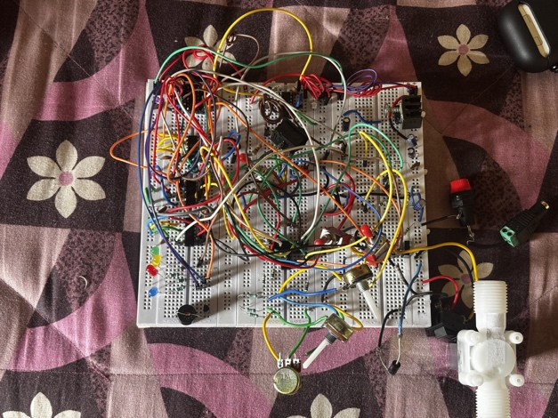
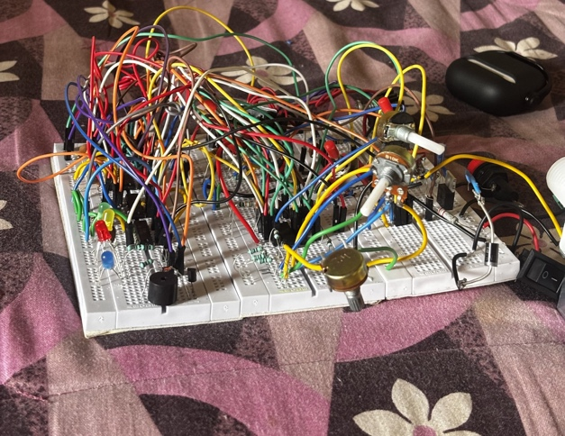
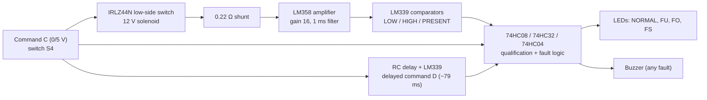
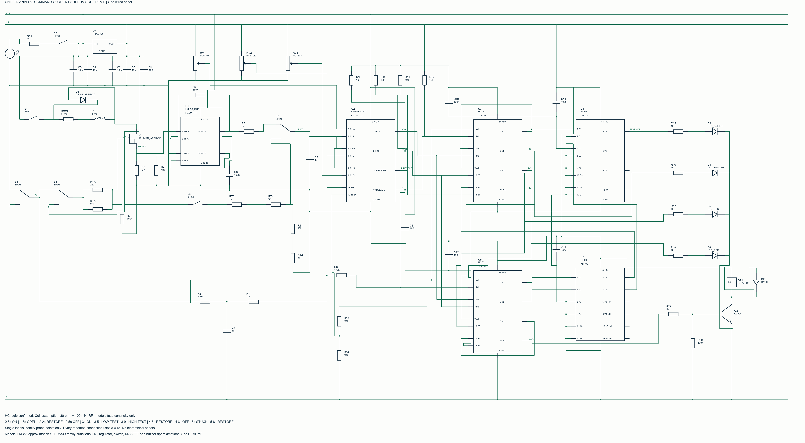
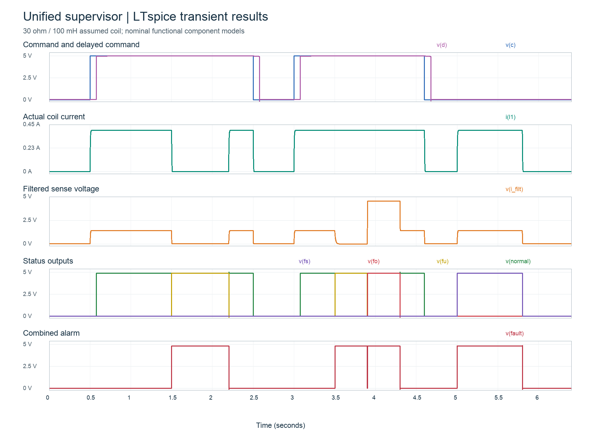

# Analog Command-Current Consistency Supervisor for Electromagnetic Actuators

A discrete analog supervisor for a 12 V electromagnetic actuator (solenoid valve). It checks that the **current the coil actually draws is consistent with the command it was given**, using only a shunt, an op-amp, comparators and fixed logic gates. There is no ADC, no microcontroller and no firmware in the decision path.

It reports four electrical conditions, each on its own LED, plus a common buzzer alarm for any fault:

| Condition | Command | Coil current | Output |
|---|---|---|---|
| Normal | ON | between LOW and HIGH thresholds | Green **NORMAL** |
| Undercurrent / open load | ON | below LOW | Yellow **FU** + buzzer |
| Overcurrent | ON | above HIGH | Red **FO** + buzzer |
| OFF-state mismatch (stuck driver) | OFF | above PRESENT | Red **FS** + buzzer |

Electrical consistency does **not** prove plunger motion, fluid flow or successful mechanical actuation.

**Course project:** Analog Electronics (BAECE203), School of Electronics Engineering (SENSE)
**Authors:** J D Abishek Singh, Eraiyanbu B, Thaadshayini
**Faculty:** Sathyanarayanan P

---

## Hardware prototype

Breadboard build with discrete ICs, potentiometers for the thresholds, LEDs, manual test switches, and an external solenoid valve.

| Overhead view | Oblique view |
|---|---|
|  |  |

Hardware testing produced the expected LED and buzzer indications for every case in the table below. These are qualitative observations (which LED and buzzer state appeared); all numerical current, voltage and timing values in this repo come from simulation.

## How it works



- **Sensing:** `Vsense = (1 + 150k/10k) × 0.22 Ω × Icoil = 3.52 V/A`.
- **Thresholds** (set by three trimpots, shown for a 0.40 A coil): LOW ≈ 0.85 V (0.24 A), HIGH ≈ 2.11 V (0.60 A), PRESENT ≈ 0.21 V (0.06 A).
- **Command qualification:** a 100 kΩ / 1 µF network and a fourth comparator produce a delayed command `D`. Decisions are only made when the raw command `C` and `D` agree, which avoids false alarms while current is rising or decaying.

```
Q       = C AND D            (ON-qualified)
OFF_ARM = NOT(C OR D)        (OFF-qualified)
FU      = Q AND LOW
FO      = Q AND HIGH
FS      = OFF_ARM AND PRESENT
NORMAL  = Q AND NOT(LOW OR HIGH)
FAULT   = FU OR FO OR FS
```

- **Low-power commissioning method:** a selector (S2) can swap the comparator input from the real amplifier output to a resistor divider test node (about 0 V or 4.53 V), so the FU and FO indication chains can be checked **without** creating a real coil fault and without high-wattage load resistors. The 33 Ω parts are used only in this divider, dissipating about 7 µW each. This test exercises the comparators, logic and alarm; it does not verify the full current-sensing path. The open-load and stuck-driver tests do exercise the real shunt and amplifier.

For a full walkthrough of each stage, see [docs/circuit-description.md](docs/circuit-description.md).

## Simulation (LTspice)

The complete circuit is one connected schematic: [`simulation/ltspice/Unified_Supervisor.asc`](simulation/ltspice/Unified_Supervisor.asc).



Open the `.asc` in LTspice and click **Run**. Setup steps, model sources and limits are in [simulation/README.md](simulation/README.md).

### Transient waveforms (6.4 s test sequence)



A single run steps through ten operating windows, driven by the switch schedule:

| Time | Action | Expected result |
|---|---|---|
| 0.5 s | Command ON | Green NORMAL after about 79 ms |
| 1.5 s | Open the load (S1) | Yellow FU + buzzer |
| 2.2 s | Restore the load | Green NORMAL |
| 2.5 s | Command OFF | All off, no false alarm |
| 3.0 s | Command ON | Green NORMAL |
| 3.5 s | Sense test, low | Yellow FU + buzzer (real coil current unchanged) |
| 3.9 s | Sense test, high | Red FO + buzzer (real coil current unchanged) |
| 4.3 s | Back to normal sensing | Green NORMAL |
| 4.6 s | Command OFF | All off |
| 5.0 s | Force driver ON with command OFF (S5) | Red FS + buzzer |
| 5.8 s | Release | All off |

### Results (LTspice 17.2.4, nominal models)

| Case | Coil current | Sense voltage | NORMAL | FU | FO | FS | Alarm | Result |
|---|---|---|---|---|---|---|---|---|
| Idle | ~0 A | 0.035 V | 0 | 0 | 0 | 0 | 0 | PASS |
| Normal ON | 0.3957 A | 1.428 V | 1 | 0 | 0 | 0 | 0 | PASS |
| Open load | ~0 A | 0.035 V | 0 | 1 | 0 | 0 | 1 | PASS |
| Restored load | 0.3957 A | 1.428 V | 1 | 0 | 0 | 0 | 0 | PASS |
| Normal OFF | ~0 A | 0.035 V | 0 | 0 | 0 | 0 | 0 | PASS |
| Low sense test | 0.3956 A | 0.0001 V | 0 | 1 | 0 | 0 | 1 | PASS |
| High sense test | 0.3956 A | 4.532 V | 0 | 0 | 1 | 0 | 1 | PASS |
| Sense restored | 0.3957 A | 1.428 V | 1 | 0 | 0 | 0 | 0 | PASS |
| Stuck driver | 0.3956 A | 1.427 V | 0 | 0 | 0 | 1 | 1 | PASS |
| Final OFF | ~0 A | 0.035 V | 0 | 0 | 0 | 0 | 0 | PASS |

Other measured values: command-to-delayed-command rising delay **79.08 ms**, minimum 5 V rail **4.998 V**. The high sense test leaves real coil current at 0.3956 A, confirming that it does not create a real overcurrent. Raw data: [`Test_Results.csv`](simulation/ltspice/results/Test_Results.csv), [`Validation.json`](simulation/ltspice/results/Validation.json).

## Repository layout

```
.
├── README.md
├── LICENSE
├── simulation/
│   ├── README.md                 How to run, models used, limits
│   └── ltspice/
│       ├── Unified_Supervisor.asc        Editable schematic (open this)
│       ├── Unified_Supervisor.cir / .net Batch netlist / LTspice-generated netlist
│       ├── UnifiedSupervisor20261028.lib Model library
│       ├── UnifiedSupervisor20261028/    Custom symbols (.asy)
│       ├── Install_Mac.command           Installs symbols and models on macOS
│       └── results/                      .raw, .plt, logs, CSV/JSON, PNGs
├── hardware/
│   ├── README.md                 Prototype notes, switch states, test procedure
│   ├── photos/                   Breadboard photographs
│   ├── schematics/               REV G hand-build schematic, 7 sheets (PDF + PNG)
│   └── bom/parts_inventory_source.csv
└── docs/
    ├── circuit-description.md    Stage-by-stage design explanation
    ├── report/                   Project report (PDF, DOCX)
    ├── paper/                    IEEE-style conference paper (analytical)
    ├── presentation/             Slides
    └── archive/                  Earlier document revisions
```

## Scope and limitations

- Simulation uses a **nominal functional model** with an assumed 30 Ω / 100 mH coil. The real coil resistance, inductance and plunger-position dependence are not modeled or validated.
- Temperature rise, component tolerance corners, fuse interruption, adapter current limiting and mechanical motion are outside the validation.
- The design has no fault latch and no automatic shutdown. A fault indication does not remove coil power.
- Thresholds must be set from the measured warm normal current of the actual actuator.
- The individual circuit elements are standard. The contribution is the specific integration: command qualification, an explicit OFF-state mismatch output, and the low-power commissioning path.

## Documentation

- [Project report](docs/report/Report_Updated_References.pdf)
- [Conference-style paper](docs/paper/actuator-supervisor-ieee-conference-paper.pdf) (analytical evaluation only)
- [Presentation](docs/presentation/actuator-supervisor-teacher-ready-revised.pptx)

## License

Released under the MIT License (see [LICENSE](LICENSE)). The model library `UnifiedSupervisor20261028.lib` includes third-party model content (a Texas Instruments LM339/LM2901 model and an Analog Devices universal op-amp core) that remains under its original terms; see [simulation/README.md](simulation/README.md).
