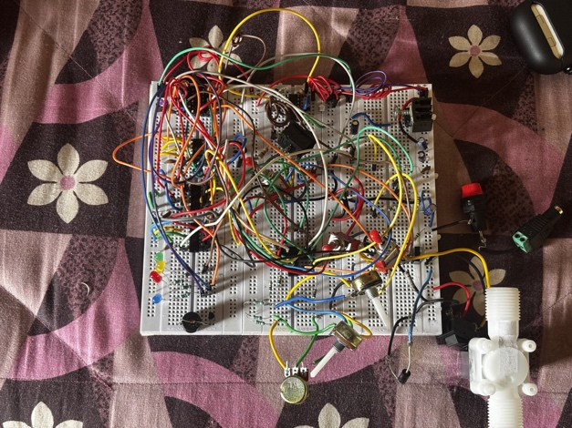
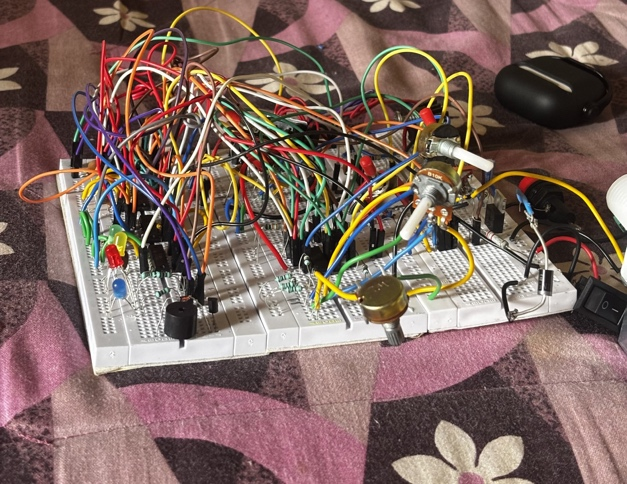

# Hardware prototype

Breadboard prototype: discrete ICs (LM358, LM339, 74HC08 x2, 74HC32, 74HC04, 7805), three threshold potentiometers, four status LEDs, a 5 V active buzzer, manual selector switches and an external 12 V normally-closed solenoid valve.

## Switch functions

| Switch | Function | Normal position |
|---|---|---|
| S0 | Master power | closed |
| S1 | Opens the load circuit (genuine open-load test) | closed |
| S2 | Comparator input: real sense signal or test node | NORMAL |
| S3 | Test level: open gives about 0 V, closed gives about 4.53 V (with S2 in TEST) | open |
| S4 | Command ON / OFF | OFF to start |
| S5 | Driver: follows command, or forced ON (stuck-driver test) | NORMAL |

Start with S4 OFF, S5 NORMAL, S2 NORMAL, S3 open. Change one test at a time and leave at least 0.5 s between command changes so the delay network can settle.

## Test coverage

| Test | Stimulus | What it proves |
|---|---|---|
| Normal | S4 ON | Real sensing path |
| Open load | Open S1 while ON | Real undercurrent detection |
| Low sense | S2 TEST, S3 open | Injected low level through comparator, logic and alarm |
| High sense | S2 TEST, S3 closed | Injected high level through comparator, logic and alarm (not a real overcurrent) |
| Stuck driver | S4 OFF, S5 STUCK | Real OFF-state mismatch detection |

## Build notes

- The sheets are REV G; the simulation is REV F. REV G adds 1 kΩ and 10 kΩ series resistors around each threshold potentiometer after the HIGH and PRESENT pots burned during adjustment (sheets 6 and 7). The cause was recorded as unconfirmed, likely a wiring or short fault.
- Sheet 7 also records an unresolved 4.55 V reading on the populated 5 V rail, to be checked before restart.
- Set the three references from the measured warm normal sense voltage of your own actuator.

## Parts

[`bom/parts_inventory_source.csv`](bom/parts_inventory_source.csv) is the original inventory list. Its R_DEG / R_OC 33 Ω "power fault" entries are superseded: the two 33 Ω resistors are used only in the low-power sense-test divider, and no 33 Ω resistor is in the 12 V load path.

## Photo note

The photos are the 627-pixel images embedded in the report. If you have the original camera files (the report cites IMG_8749.HEIC and IMG_8750.HEIC), convert them to JPG and replace these for sharper images.
